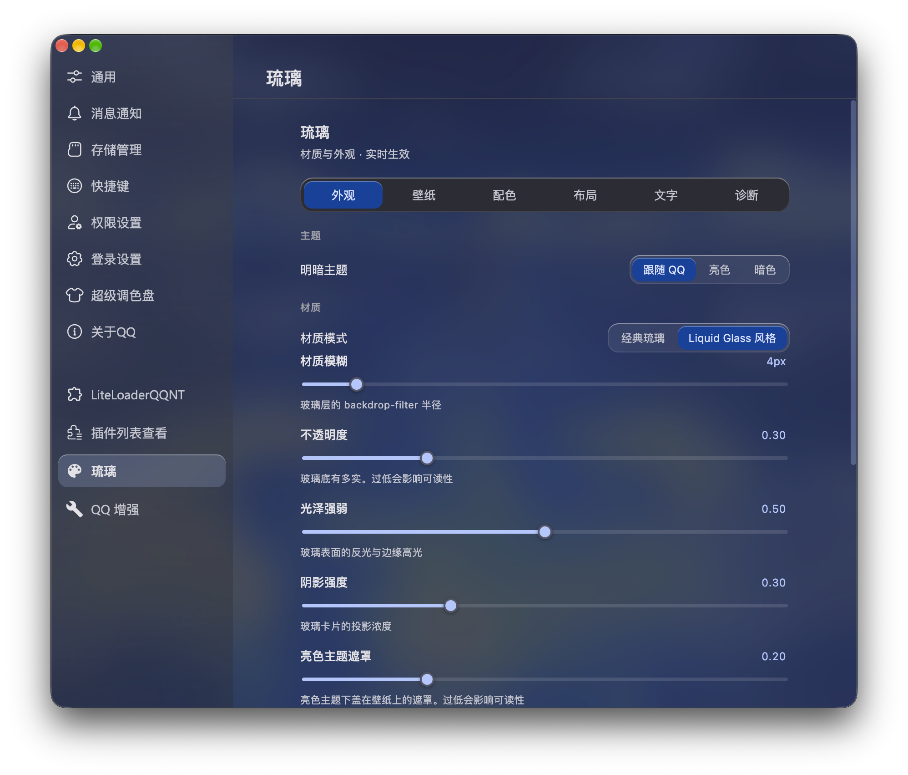

> [!IMPORTANT]
> 这是 [Oceansdd/qqnt-liuli-theme-macOS](https://github.com/Oceansdd/qqnt-liuli-theme-macOS) 的 **macOS / LiteLoaderQQNT 适配版** README，对应 **`liteloader` 分支**。
> 本项目 Fork 自 [LilycleHeart/qqnt-liuli-theme](https://github.com/LilycleHeart/qqnt-liuli-theme)，原作者为 LilycleHeart。原项目的 SnowLora 版本可参见 [main 分支](https://github.com/Oceansdd/qqnt-liuli-theme-macOS/tree/main)。

<div align="center">

# 🌊 琉璃 Liuli · macOS

**QQNT 主题 · macOS 兼容改造与配置持久化修复**

[](#支持的环境)
[](#支持的环境)
[](https://github.com/LiteLoaderQQNT/LiteLoaderQQNT)

</div>

从壁纸取色，通过 Material Color Utilities 派生 Material 3 动态配色，为 QQNT 提供亚克力玻璃风格界面。**无需 BetterQQNT。**

> [!NOTE]
> 默认使用经典琉璃的 **CSS 亚克力材质**。**Liquid Glass 风格** 使用 CSS 绘制，可在外观设置中切换。

## 📸 预览

<div align="center">

<br />
<sub>原项目示意图；macOS 的实际窗口布局可能不同</sub>
<br /><br />

</div>

## ✨ 功能

| | 功能 | 说明 |
|---|---|---|
| 💾 | **macOS 配置持久化** | 布局、菜单、壁纸、裁剪/适配参数、配色、字体、Markdown 开关及明暗模式在重新启动 QQ 后恢复 |
| 🪟 | **独立聊天窗口清晰壁纸** | 取消独立聊天窗口额外的 24px 背景模糊，并降低辅助遮罩透明度，不影响消息气泡 |
| 🎨 | **动态色板** | 根据壁纸实时派生 Material 3 色板；自定义强调色、选中项及双方气泡角色 |
| 🧊 | **亚克力玻璃** | 会话列表、详情栏、弹层与菜单使用半透明材质 |
| 💬 | **三种聊天气泡** | TG、原版、TIM 可切换；TG 使用琉璃气泡，原版与 TIM 保留 QQ 个性装扮 |
| 📝 | **Markdown 行内渲染** | 支持代码、粗体、斜体、删除线、剧透等行内语法（功能移植自 BetterQQNT） |
| 🔔 | **@ 高亮** | 区分 @我、@全体成员与 @其他人 |
| 🌐 | **卡片用浏览器打开** | 支持对部分 QQ 小程序卡片提取网页链接并交给默认浏览器 |
| 🖌️ | **名称配色** | 使用 MCU 派生的第三色 |
| 🌀 | **消息入场动画** | 会话消息级联入场，遵守系统减少动画设置 |
| 🔤 | **自定义字体** | 可以选择本机安装的字体 |
| 🧩 | **布局自定义** | 消息右键菜单、输入框工具、侧边栏与标题栏等选项 |
| 🩺 | **诊断工具** | 导出环境、日志及主题快照，排查启动或壁纸问题 |

## 📦 macOS 安装

### 支持的环境

| 项目 | 已实际验证版本 |
|---|---|
| macOS | **27** |
| QQNT for macOS | **6.9.97-50776** |
| LiteLoaderQQNT | **1.4.1** |
| Electron | **37.1.0** |
| Chromium | **138.0.7204.35** |
| Node.js | **22.16.0** |

**上述为实机测试组合，不等于其他版本完全不兼容。** 其他版本未经充分测试，请自行备份后尝试。上游针对 Windows 9.9.36 的说明不适用于本 Fork。

### 手动安装

1. 先按 [LiteLoaderQQNT 官方安装指南](https://liteloaderqqnt.github.io/guide/install.html) 在 Mac 上安装 LiteLoader，确认 QQ 设置页能看到 LiteLoaderQQNT。
2. **完全退出 QQ**，而不是仅关闭窗口。
3. 打开 Finder，按 `Command + Shift + G`，输入：

   ```text
   ~/Library/Containers/com.tencent.qq/Data/Documents/LiteLoaderQQNT/plugins/
   ```

4. 下载本 Fork 的 [`liteloader` 分支](https://github.com/Oceansdd/qqnt-liuli-theme-macOS/tree/liteloader)，将代码放入该目录下的 `liuli-dsh-theme` 文件夹。必须确保 `manifest.json` **直接位于** `liuli-dsh-theme/manifest.json`，不能再套一层 ZIP 根目录。
5. 如果曾安装旧版琉璃，先将旧插件目录**移出 `plugins` 文件夹备份**，再安装当前版本，避免两个副本同时加载。
6. 启动 QQ，在设置 → **琉璃** 中选择壁纸、配色和布局；然后完整退出并重新启动 QQ，验证配置正常恢复。

如果该目录里还没有 `liuli-dsh-theme`，也可用 Git 安装：

```bash
PLUGINS="$HOME/Library/Containers/com.tencent.qq/Data/Documents/LiteLoaderQQNT/plugins"
mkdir -p "$PLUGINS"
git clone --branch liteloader --single-branch \
  https://github.com/Oceansdd/qqnt-liuli-theme-macOS.git \
  "$PLUGINS/liuli-dsh-theme"
```

> 本 Fork **不提供 Windows `.exe` 安装器**，也不需要将 `dbghelp.dll` 或 Windows 版 `QQ.exe` 复制到 Mac。不要照搬上游 Windows 教程中的这些步骤。

### 配置持久化与备份

本次 macOS 改造通过 LiteLoader 的数据目录保存配置，而不只依靠 `localStorage`：

```text
~/Library/Containers/com.tencent.qq/Data/Documents/LiteLoaderQQNT/data/liuli-dsh-theme/
├── layout.json               布局、菜单选项
├── appearance.json           配色、字体、Markdown、明暗模式
├── wallpaper.json            壁纸元数据和裁剪/适配选项
└── wallpaper-<sha256>.bin     本机壁纸图片
```

备份或迁移时，建议同时保留 `plugins/liuli-dsh-theme/` 和 `data/liuli-dsh-theme/`。**不要把个人配置、壁纸图片或诊断包提交到公共 GitHub 仓库。**

## 🗂️ 源码结构

```text
manifest.json               LiteLoader 插件清单
main/index.js               主进程 IPC、诊断、布局/壁纸/外观配置持久化
preload/index.js            向渲染进程暴露 IPC 接口
renderer/index.js           动态取色、壁纸、Markdown、字体、设置页等
renderer/layout-custom.js   布局及菜单自定义、数据恢复
renderer/diag.js            诊断快照与日志
assets/layout-custom.css    独立聊天窗口背景适配等 CSS
assets/                     其他样式、MCU、图标与预览素材
```

## 🖼️ 壁纸及独立聊天窗口

插件不附带个人默认壁纸。打开 QQ 设置 → 琉璃，选择图片后会自动提取主题色。

在独立聊天窗口中，原主题额外施加了半透明层和模糊效果；本 Fork 调整为**辅助遮罩约 10%、额外背景模糊关闭**。这样可以保持聊天背景清晰，而消息气泡等仍按主题样式显示。

可在「琉璃 → 外观 → 独立聊天背景」调整亚克力遮罩浓度与背景模糊，设置在重启后保留。它不同于壁纸明暗遮罩。

### 壁纸或配置重启后丢失？

1. 完全退出再打开 QQ；只刷新设置页不等于让主进程重新加载。
2. 检查 `data/liuli-dsh-theme/` 中的 `wallpaper.json`、`appearance.json`、`layout.json` 是否存在。
3. 若壁纸有裁剪选区，请同时确认对应的 `wallpaper-<sha256>.bin` 存在；不要直接清空数据目录。
4. 在设置 → 琉璃 → 诊断中导出诊断包辅助定位。分享前先检查是否包含私人信息或窗口截图。

## 🩺 诊断与隐私

原主题提供诊断导出，可检查插件加载状态、错误日志、壁纸应用状态等。**诊断文件可能包含窗口截图、环境路径等信息**；上传 GitHub Issue 或公开分享前请自行审查脱敏。不要提交聊天数据库、QQ 账号资料或本地壁纸。

## 🕳️ 开发注意事项

- `data-hash` 与 `data-liuli-scope` 在部分 QQNT 路由切换时需要主动同步。
- `--ll-*` CSS 变量不能缺失，否则可能导致相关声明静默无效。
- 壁纸在 `#app::before`；请避免额外覆盖和多层全屏遮罩。
- 有些菜单包含 `position:fixed` 子菜单，不应直接给父菜单添加会改变定位上下文的 `transform` 或 `backdrop-filter`。
- 主窗口与独立窗口有不同层级关系，修改独立窗口时应排除语音/视频通话窗口。
- 设置持久化涉及 `main`、`preload`、`renderer`，改动后需完整重启 QQ。

## Liquid Glass 风格（实验）

在 QQ 设置 → 琉璃 → 外观 → 材质模式中切换「经典琉璃」和「Liquid Glass 风格」。已有配置默认使用经典琉璃，模式随其他外观设置保存在 `appearance.json`。

样式通过 `assets/liquid-glass.css` 在 `layout-custom.css` 之后注入。主窗口的侧边栏、会话列表、琉璃顶部窗口控件和消息右键菜单使用方向性高光和边缘阴影。菜单沿用原有伪元素材质，壁纸、消息、输入框与独立窗口沿用各自的样式。系统开启降低透明度时，上述玻璃表面使用实色并关闭背景模糊。顶部窗口控件响应系统减少动态效果设置。

### macOS 实机验收

1. 完全退出 QQ，备份当前插件目录到 `plugins` 外，换入功能分支。保留 `data/liuli-dsh-theme`。
2. 从已有配置启动，确认默认是经典琉璃。切换材质，观察主窗口即时更新。分别检查亮色、暗色、深浅壁纸、侧栏固定和悬浮状态。
3. 检查消息右键菜单及子菜单位置、窗口拖拽与按钮、会话切换、长列表滚动、消息滚动、输入及发送。对比独立聊天壁纸、设置及通话窗口。
4. 在系统「辅助功能 → 显示」分别开启降低透明度、减少动态效果，在 QQ 中检查对应变化。确认经典琉璃可随时切回。
5. 选中 Liquid Glass 风格后用 ⌘Q 完全退出，再启动检查材质、布局、壁纸裁剪、配色、字体、Markdown 和明暗模式。切回经典琉璃后再重启一次。

材质问题可立即切回经典琉璃。若需回退代码，完全退出 QQ 后恢复备份插件目录，保留原数据目录。

## 📋 后续计划

- 在更多 macOS / QQNT 版本上验证兼容性。
- 补充 macOS 聊天界面实机截图。
- 继续完善字体、壁纸和明暗模式细节。
- 探索 macOS **原生 Liquid Glass** 的可行性；**目前尚未实现**。

---

<div align="center">
<sub>原项目：<a href="https://github.com/LilycleHeart/qqnt-liuli-theme">LilycleHeart/qqnt-liuli-theme</a> · macOS Fork：<a href="https://github.com/Oceansdd/qqnt-liuli-theme-macOS">Oceansdd/qqnt-liuli-theme-macOS</a> · 基于 <a href="https://github.com/LiteLoaderQQNT/LiteLoaderQQNT">LiteLoaderQQNT</a></sub>
</div>
